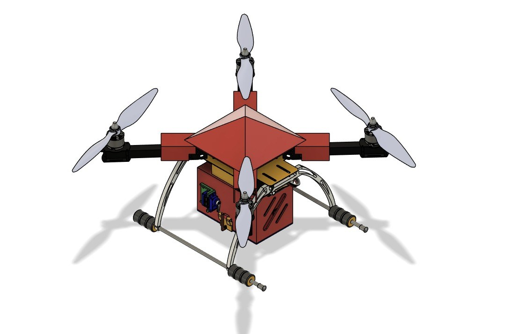
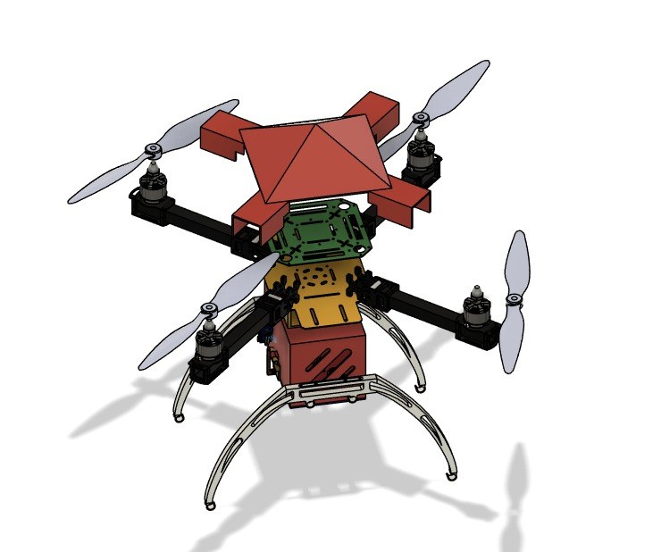
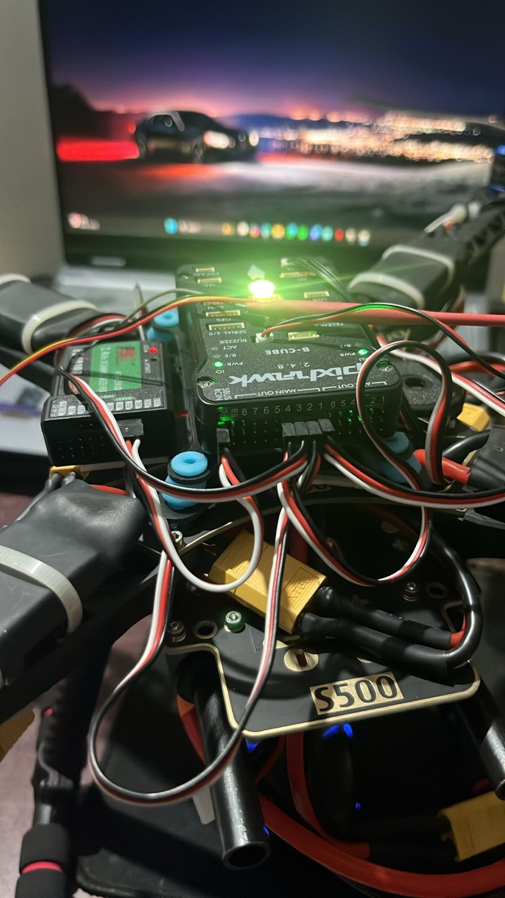

# servo based Payload mechanism in UAV

A carbon-fibre drone prototype developed around a payload box with a **single-servo actuation mechanism**. The payload box was designed around an approximately **200 g load**. When the servo opens the box mechanism, the payload is intended to drop under gravity.

## Project design

The central feature is the servo-operated payload box. The servo actuates the opening mechanism; gravity provides the downward movement of the released payload.

## Build progress and result

Our team successfully built the carbon-fibre drone prototype. The payload-release operation described here is the intended mechanism; a completed airborne release test and a measured 200 g carrying test still need confirmation.

| Item | Details |
| --- | --- |
| Airframe | Carbon-fibre drone prototype |
| Payload design figure | Approximately 200 g |
| Payload mechanism | One servo actuating a payload box |
| Release principle | Gravity drop after opening |
| Confirmed result | Physical drone prototype built |

## Design and prototype views

## Videos

- [Payload mechanism CAD animation](media/videos/video-2025-05-22-22-11-30.mp4)
- [Prototype hardware demonstration](media/videos/video-2025-11-14-19-54-07.mp4)
